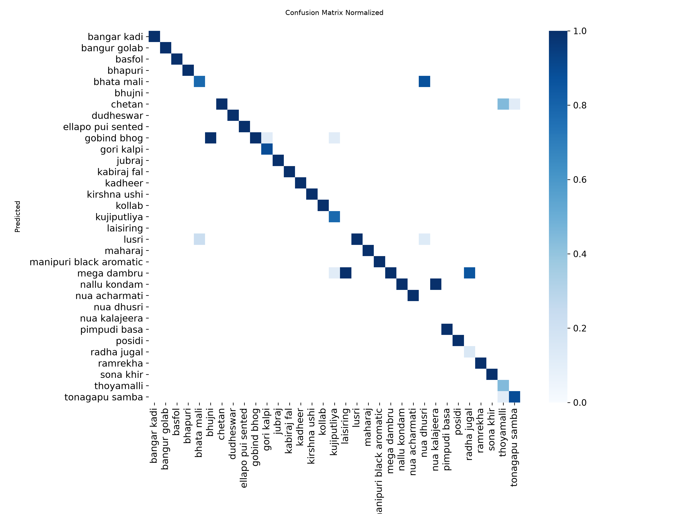

# CropAI — AI-Based Crop Identification and Farm Analysis

CropAI is an AI-powered application developed to explore rice variety identification using image classification and video analysis.

The project combines computer vision, deep learning and a Streamlit-based interface to process uploaded farm images and videos.

## Project Overview

The application is designed to:
- Identify rice varieties from uploaded images.
- Analyse uploaded farm videos using sampled frames.
- Generate prediction summaries and downloadable CSV reports.
- Display model confidence scores for predicted rice varieties.

## Technology Stack

- Python
- Streamlit
- Ultralytics YOLO
- OpenCV
- Pandas
- Pillow

## Current Model

The project uses a YOLO11n classification model (`models/best.pt`, about 3.2 MB) covering 33 rice variety classes.

## Run Locally

Developed and tested on Windows 11 with Python 3.12.10. The trained model is included in the repository, so no training is needed to run the app.

    git clone https://github.com/muditbillore-prog/CropAI.git
    cd CropAI
    python -m venv .venv
    source .venv/Scripts/activate      # Git Bash on Windows
    pip install -r requirements.txt
    streamlit run app.py

On Linux or macOS, activate the environment with `source .venv/bin/activate` instead. The training dataset is not included in this repository.

## Evaluation Results

Two evaluations are reported. The second is stricter and is the more realistic estimate; the first is kept because it is how the deployed model was originally measured.

| Evaluation | Model | Test images | Top-1 | Top-5 |
| --- | --- | ---: | ---: | ---: |
| Random split (original) | `models/best.pt` (used by the dashboard) | 324 | 99.07% | 100.00% |
| Time-ordered split (stricter) | model trained on the time-ordered split | 288 | 83.33% | 94.44% |

**Why the first number is misleading.** Each variety was photographed in one short sitting and the original split was random. A similarity check (64-bit difference hash) found that 193 of the 324 test images have a near-identical training image of the same variety. Accuracy was 100% on the 304 test images with a close training neighbour (hash distance up to 15) and 85% (17 of 20) on the 20 distinct ones, so 99.07% overstates how well the model handles photos it has not effectively seen.

**The stricter split.** `make_time_ordered_split.py` sorts each variety's images by the capture time in the file name and cuts them into consecutive train, validation and test blocks, dropping a few images (a buffer of 6) between blocks. Test images with a near-identical training image fall from 193 of 324 to 34 of 288. A model trained on this split scores 87.0% Top-1 on validation and 83.33% on the test set.

**What this still does not show.** Both evaluations use photos from the same sittings as the training photos, so neither measures performance on other days, fields, cameras or lighting. A truly independent test would need new photographs. The 288-image test set gives roughly ±4 percentage points of uncertainty if images were independent, which they are not, so the real uncertainty is larger, and some varieties have as few as 5 test images.

Full methodology, the overlap analysis and the training configuration are in [docs/MODEL_DOCUMENTATION.md](docs/MODEL_DOCUMENTATION.md). To reproduce, with the dataset available locally:

    python evaluate_rice_classifier.py
    python check_split_leakage.py
    python make_time_ordered_split.py --buffer 6 --write
    python train_rice_classifier.py --dataset rice_classification_time_split_v2 --run-name rice_variety_time_split_v2
    python evaluate_rice_classifier.py --model runs/rice_classification/rice_variety_time_split_v2/weights/best.pt --dataset rice_classification_time_split_v2

## Limitations

- CropAI classifies the rice variety shown in an image. It does not detect individual plants.
- It does not diagnose crop disease or provide a validated crop-health score.
- Video analysis works on sampled frames and is not a field-level survey.
- Each variety was photographed in one short sitting, so all reported accuracy measures performance on similar photos, not on other fields, cameras, lighting or growth stages. The original 99.07% result also overlaps with the training photos; see Evaluation Results.
- Model confidence scores are predictions, not guarantees of real-world accuracy.

## Development Status

CropAI is under active development. This repository documents the project's implementation, model integration, evaluation and improvements progressively.
