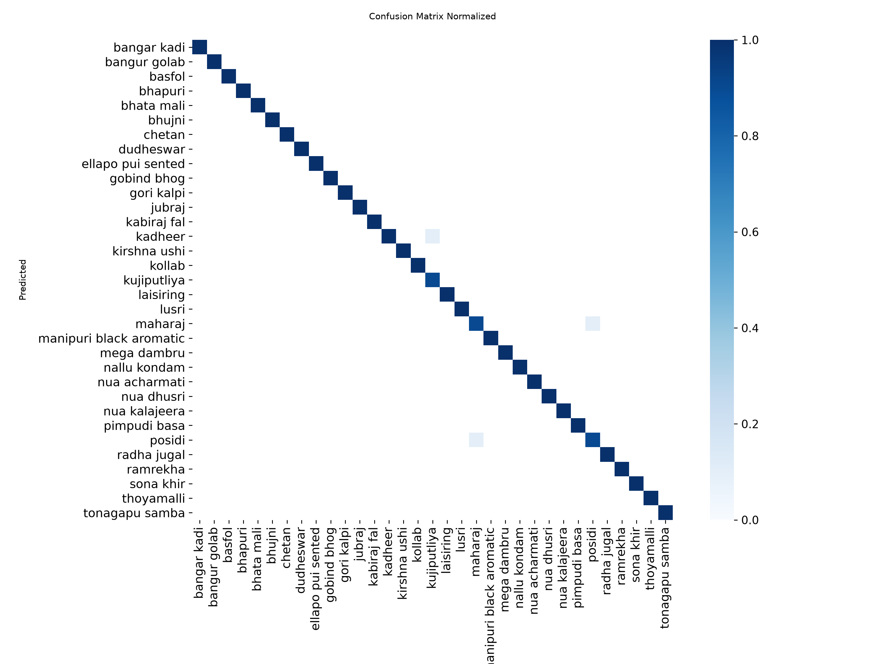
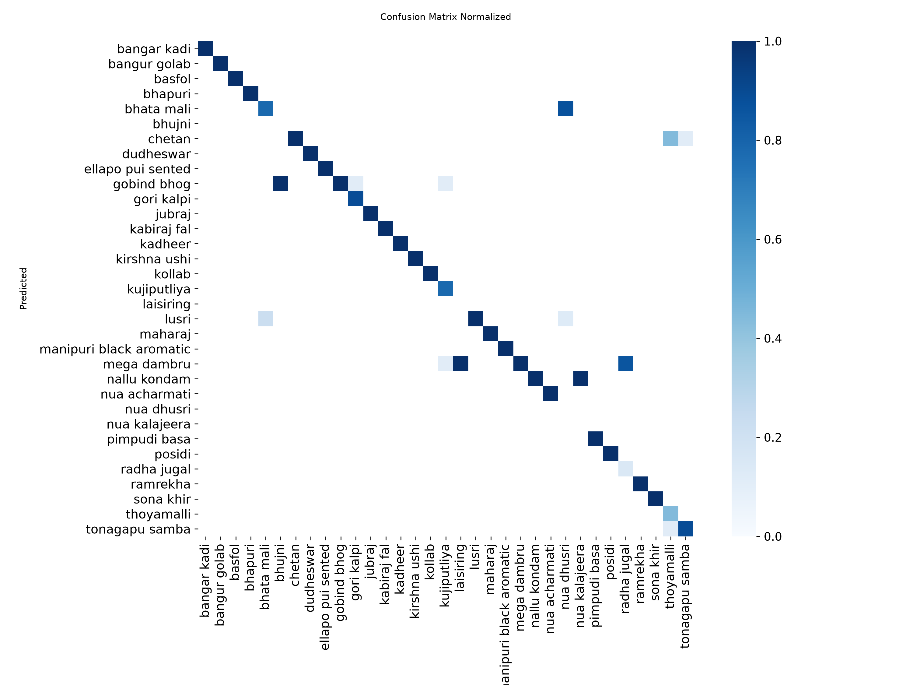

# CropAI — Model Documentation

## 1. Project Overview

CropAI is an AI-powered rice variety classification project designed to identify rice varieties from uploaded images and video frames.

The application uses a trained YOLO11 classification model to predict the most likely rice variety and display prediction confidence scores.

CropAI provides a Streamlit-based dashboard for image and video analysis, Top-5 predictions, CSV report generation, and maturity planning calculations.

## 2. Technology Stack

| Component | Technology |
|---|---|
| Programming Language | Python |
| Machine Learning Framework | Ultralytics |
| Model Architecture | YOLO11n Classification |
| Image Processing | OpenCV |
| Dashboard | Streamlit |
| Data Handling | Pandas |
| Image Handling | Pillow |

## 3. Dataset Information

The project uses a cleaned rice classification dataset.

Dataset directory:

`datasets/rice_classification_clean_v1`

Dataset statistics:

| Dataset Split | Number of Images |
|---|---:|
| Training | 2,476 |
| Validation | 302 |
| Testing | 324 |
| Total | 3,102 |

The dataset contains 33 rice variety classes organized into separate class folders.

The dataset is not included in the GitHub repository.

The cleaned dataset was made from the raw `Primitive_Rice_OnField_new` folder (3,299 image files) by `clean_rice_dataset.py`. Images are grouped by content hash: 32 groups of identical images filed under more than one variety (87 files) were quarantined as conflicting labels, 110 further copies of images with a single label were removed as duplicates, and one copy of each remaining image (3,102 in total) was split 80/10/10 per variety with a fixed seed. `audit_original_dataset.py` reports the duplicate counts for the raw data, and `validate_clean_dataset.py` checks the result: every variety appears in every split, no exact duplicate appears in more than one split, and the cleaning manifest matches the files on disk. These checks catch exact duplicates only; see Section 7 for near-duplicates.

A second split of the same images, `datasets/rice_classification_time_split_v2`, was created by `make_time_ordered_split.py` and is described in Section 7:

| Dataset Split | Number of Images |
|---|---:|
| Training | 2,148 |
| Validation | 270 |
| Testing | 288 |
| Dropped (buffer between blocks) | 396 |
| Total | 3,102 |

## 4. Model Architecture

CropAI uses the YOLO11n Classification model provided by Ultralytics.

The model is trained for image classification rather than object detection.

The model predicts the rice variety represented in an input image and returns class probabilities.

Trained model location:

`models/best.pt`

Model type: YOLO11n Classification

## 5. Training Configuration

The training script is:

`train_rice_classifier.py`

The configured training parameters are:

| Parameter | Value |
|---|---|
| Model | YOLO11n Classification |
| Epochs | 20 |
| Image Size | 224 × 224 |
| Batch Size | 8 |
| Device | CPU |
| Workers | 0 |
| Patience | 5 |
| Random Seed | 42 |

Training starts from the pretrained `yolo11n-cls.pt` weights. The original run (`rice_variety_clean_v1`) ended after 12 of the 20 epochs (733 s on the CPU): validation Top-1 first reached 99.669% at epoch 7 and did not improve in the next five epochs, which matches the patience setting of 5. The run on the time-ordered split is described in Section 7.

The training script checks the dataset directories and class-folder consistency before starting training.

It also prevents accidental overwriting of an existing training run.

## 6. Validation Results

The recorded validation results are:

| Metric | Result |
|---|---:|
| Top-1 Accuracy | 99.669% |
| Top-5 Accuracy | 100% |

These results represent validation performance on the original random split and are reported separately from test-set performance. They share the overlap with the training images described in Section 7, so they overstate performance on new photos. A model trained on the time-ordered split reached 87.0% Top-1 and 93.7% Top-5 on its own validation set (270 images).

## 7. Test Evaluation

The original test evaluation (random split) was completed using:

`evaluate_rice_classifier.py`

The evaluation uses the separate test dataset split containing 324 images across 33 rice variety classes.

### Test Results (Original Random Split)

| Metric | Result |
|---|---:|
| Test Images | 324 |
| Number of Classes | 33 |
| Top-1 Accuracy | 99.07% |
| Top-5 Accuracy | 100.00% |

The model achieved 99.07% Top-1 accuracy and 100% Top-5 accuracy on this test split. These figures overstate performance on new photos because many test images have near-identical training images; see the overlap analysis below.

Top-1 accuracy measures whether the highest-ranked prediction matches the actual class.

Top-5 accuracy measures whether the correct class appears among the five highest-ranked predictions.

### Evaluation Configuration

| Parameter | Value |
|---|---|
| Dataset Split | Test |
| Image Size | 224 × 224 |
| Batch Size | 8 |
| Device | CPU |
| Workers | 0 |
| Framework | Ultralytics 8.4.183 |

### Confusion Matrix

The normalized confusion matrix provides a class-wise view of the model's classification performance.



The diagonal represents correct classifications, while off-diagonal entries indicate misclassifications.

The evaluation results are specific to this test dataset and do not guarantee identical performance on unseen real-world field conditions.

### Overlap Between Training and Test Images

Each variety was photographed in one short sitting (file-name timestamps show one date per variety and mostly 1-6 minutes per variety), and the original split was random. For every test image, `check_split_leakage.py` finds the most similar training image of the same variety using a 64-bit difference hash (a crude similarity measure) and reports accuracy by Hamming distance:

| Distance to nearest training image | Test images | Correct | Accuracy |
|---|---:|---:|---:|
| 0-5 (near-identical) | 193 | 193 | 100.00% |
| 6-10 | 70 | 70 | 100.00% |
| 11-15 | 41 | 41 | 100.00% |
| > 15 (distinct) | 20 | 17 | 85.00% |

Many source files carry suffixes such as `_01`, `_1` and `_2` and share a capture time with another file; the origin of these files is unknown. Exact duplicates were removed by `clean_rice_dataset.py`, but near-copies were not. The 99.07% result therefore overstates how well the model handles photos that do not resemble its training images.

### Time-Ordered Split Evaluation

`make_time_ordered_split.py` builds a second dataset, `datasets/rice_classification_time_split_v2`. For each variety it sorts the images by the capture time in the file name and cuts them into consecutive train, validation and test blocks, dropping a few images (a buffer of 6) between blocks and cutting only between different seconds. The source dataset is not modified.

| Property | Random split (original) | Time-ordered split |
|---|---:|---:|
| Training / validation / test images | 2,476 / 302 / 324 | 2,148 / 270 / 288 |
| Test images with a near-identical training image (distance <= 5) | 193 | 34 |
| Test images distinct from training (distance > 15) | 20 | 233 |

A new model was trained on the stricter split with the same settings (YOLO11n-cls, 224 x 224, batch 8, CPU, seed 42, up to 20 epochs with early stopping). It stopped after 17 epochs, with the best epoch at 12 (about 15 minutes of training).

| Metric | Validation (270 images) | Test (288 images) |
|---|---:|---:|
| Top-1 Accuracy | 87.0% | 83.33% (240 / 288) |
| Top-5 Accuracy | 93.7% | 94.44% (272 / 288) |



This is the more realistic estimate, but it still measures photos taken in the same sittings as the training photos: 34 test images still have a near-identical training image, and the results say nothing about other days, fields, cameras or lighting. With 288 test images the 95% interval is about +/-4 percentage points if images were independent; they are not, so the real uncertainty is larger, and some varieties have as few as 5 test images. The dashboard still uses `models/best.pt`, the model from the original split.

### Where the Time-Ordered Model Fails

`analyze_test_errors.py` (with `--model` and `--dataset`) lists the misclassified test images and a per-variety summary. Of the 33 varieties, 23 are classified perfectly and 10 have at least one error. Five varieties account for 37 of the 48 errors, and each of them is predicted almost entirely as one other variety:

| True variety | Correct | Mostly predicted as |
|---|---:|---|
| bhujni | 0 / 9 | gobind bhog (9) |
| laisiring | 0 / 9 | mega dambru (9) |
| nua dhusri | 0 / 8 | bhata mali (7) |
| radha jugal | 1 / 7 | mega dambru (6) |
| nua kalajeera | 0 / 5 | nallu kondam (5) |

The other 11 errors come from thoyamalli (4 of 9 correct; 4 of its 5 errors are predictions of chetan), bhata mali (7 of 9), kujiputliya (7 of 9), gori kalpi (8 of 9) and tonagapu samba (8 of 9).

Each variety has only 5 to 9 test images taken in one consecutive block, so results are close to all-or-nothing per variety. The effective number of independent test blocks is closer to 33 than to 288, and the confidence interval quoted above is therefore optimistic.

The cause has not been established. A simple check compared the average colour (mean RGB) of each variety's test photos with its training photos. The five failing varieties had colour shifts of 7 to 33 (RGB distance, 0-255 scale), against a median of 9.8 for the 23 perfect varieties, which include shifts as large as 39.4. A colour shift alone therefore neither explains nor predicts the failures, although the measure cannot see grain shape or texture. Possible explanations, none of them tested, are genuine visual similarity between varieties and differences between the start and end of a sitting that average colour does not capture.

### Confidence Scores

`analyze_confidence.py` measures how well a model's confidence tracks whether it is right. On the time-ordered test set (288 images), the model trained on the time-ordered split gave:

| Confidence | Images | Correct | Accuracy |
|---|---:|---:|---:|
| below 50% | 14 | 6 | 42.9% |
| 50-70% | 29 | 13 | 44.8% |
| 70-90% | 28 | 16 | 57.1% |
| 90-100% | 217 | 205 | 94.5% |

Mean confidence was 91.0% (95.0% when correct, 71.1% when wrong) against an accuracy of 83.3%, so the model is somewhat overconfident. Confidence is informative: predictions at or above 90% were right 94.5% of the time, and those below 90% (71 images, 24.7% of the test set) only 49.3% of the time. It is not a guarantee: 12 of the 48 errors had a confidence of 90% or more.

These figures describe the model trained on the time-ordered split, not the model currently used by the dashboard (`models/best.pt`), which cannot be evaluated fairly because both test sets overlap with its training data. The test images are consecutive photos from the same sittings, and no labelled aerial footage is available, so the figures do not show how far confidence can be trusted on drone video.

### Aerial Video

`compare_models_on_video.py` runs two models on the same frames sampled from a video, as the dashboard does, and reports how often they agree and how confident each is. No labels are needed, so it cannot say which model is right. By default it compares the deployed model with the model trained on the time-ordered split, whose weights come from the training step and are not in the repository.

On three aerial farm clips (10 frames each, 30 frames in total) the two models agreed on only 8 of 30 frames (26.7%): 2 of 10, 6 of 10 and 0 of 10 in the three clips. Mean confidence was 44.9% for the deployed model and 60.2% for the time-ordered model, and 28 and 29 of the 30 frames, respectively, were below 90% confidence.

Two models trained with the same settings on overlapping sets of the same photos gave mostly different varieties for the same frames, and almost every frame was low-confidence for both. Variety predictions for aerial footage should therefore not be relied on. The training photos are close-ups of rice, and no labelled aerial footage is available to check anything further.

### Running the Evaluation

Activate the project virtual environment and execute:

```bash
python evaluate_rice_classifier.py
```

The evaluation generates confusion matrices and prediction visualizations in the Ultralytics run directory.

`evaluate_rice_classifier.py` also accepts optional `--model`, `--dataset` and `--name` arguments; the defaults reproduce the original evaluation above.

To reproduce the time-ordered evaluation (requires the dataset locally):

`````bash
python make_time_ordered_split.py --buffer 6 --write
python train_rice_classifier.py --dataset rice_classification_time_split_v2 --run-name rice_variety_time_split_v2
python evaluate_rice_classifier.py --model runs/rice_classification/rice_variety_time_split_v2/weights/best.pt --dataset rice_classification_time_split_v2 --name test_v2_time_split
python check_split_leakage.py
````

## 8. Application Features

The CropAI dashboard currently supports:

- Rice variety classification from uploaded images.
- Video analysis using sampled video frames.
- Top-5 classification predictions.
- Prediction confidence scores.
- CSV report generation.
- Maturity planning calculations.

The model classifies the most likely rice variety in the input image. Its confidence score should not be treated as a guarantee of correctness.

## 9. Installation and Setup

Use Python 3.12.10 and create a virtual environment.

```bash
python -m venv .venv
```

Activate it in Git Bash:

```bash
source .venv/Scripts/activate
```

Install dependencies:

```bash
pip install -r requirements.txt
```

Start the application:

```bash
streamlit run app.py
```

## 10. Project Limitations

- Classification performance depends on image quality, lighting, camera angle, and dataset coverage.
- The model predicts a rice variety; it does not identify individual plants.
- The application does not currently provide validated crop-health diagnosis.
- Confidence scores are model estimates, not guaranteed probabilities of correctness.
- The original test split overlaps with the training split (near-identical photos from the same sittings), so its 99.07% result overstates performance on new photos. The stricter time-ordered result is 83.33% Top-1.
- Each variety was photographed in one short sitting, according to file-name timestamps, so neither evaluation measures performance on other days, fields, cameras or lighting. A truly independent test set would need new photographs.
- The time-ordered test set has 288 images (as few as 5 per variety), so its results are statistically noisy.

## 11. Future Improvements

Potential improvements include:

- Testing with more real-world field images and videos.
- Improving robustness under different lighting and environmental conditions.
- Investigating why five varieties are mostly mistaken for one other variety each (documented above; the cause is not yet known) and improving them.
- Exploring crop-health analysis as a separate, properly validated capability.
- Expanding the dataset with additional rice varieties.

## 12. Repository Structure

| File | Purpose |
|---|---|
| `app.py` | Streamlit dashboard |
| `cropai_helpers.py` | Small tested helpers used by the dashboard: maturity estimate, low-confidence rule, safe image loading |
| `audit_original_dataset.py` | Reports duplicate and conflicting-label images in the raw dataset |
| `clean_rice_dataset.py` | Removes duplicates and conflicting labels from the raw dataset and makes the random split (v1) |
| `validate_clean_dataset.py` | Checks the cleaned dataset: every variety in every split, no exact duplicates across splits, manifest matches the files |
| `make_time_ordered_split.py` | Builds the time-ordered split (v2) |
| `train_rice_classifier.py` | Trains the classifier (`--dataset`, `--run-name`) |
| `evaluate_rice_classifier.py` | Evaluates a model on a test split (`--model`, `--dataset`, `--name`) |
| `analyze_test_errors.py` | Per-variety accuracy and most common confusions |
| `analyze_confidence.py` | Accuracy by confidence level |
| `compare_models_on_video.py` | Compares two models on frames sampled from a video |
| `check_split_leakage.py` | Measures how similar test images are to training images |
| `tests/` | Unit and smoke tests: `python -m unittest discover -s tests` |

```text
CropAI/
├── app.py
├── cropai_helpers.py
├── requirements.txt
├── LICENSE
├── train_rice_classifier.py
├── evaluate_rice_classifier.py
├── analyze_test_errors.py
├── analyze_confidence.py
├── compare_models_on_video.py
├── check_split_leakage.py
├── audit_original_dataset.py
├── clean_rice_dataset.py
├── validate_clean_dataset.py
├── make_time_ordered_split.py
├── .github/
│   └── workflows/
│       └── tests.yml
├── models/
│   └── best.pt
├── tests/
│   ├── test_maturity.py
│   ├── test_model_smoke.py
│   ├── test_time_split.py
│   ├── test_low_confidence.py
│   └── test_image_loading.py
├── docs/
│   ├── MODEL_DOCUMENTATION.md
│   └── images/
│       ├── confusion_matrix_test.png
│       └── confusion_matrix_test_time_split.png
└── datasets/            (local only, not in the repository)
    ├── rice_classification_clean_v1/
    └── rice_classification_time_split_v2/
```

The dataset and local training artifacts are excluded from the GitHub repository.

---

**Documentation status:** Training, validation, and two test evaluations (an original random split and a stricter time-ordered split) have been completed and documented. Test results are based on the current dataset and should not be interpreted as guaranteed real-world performance.