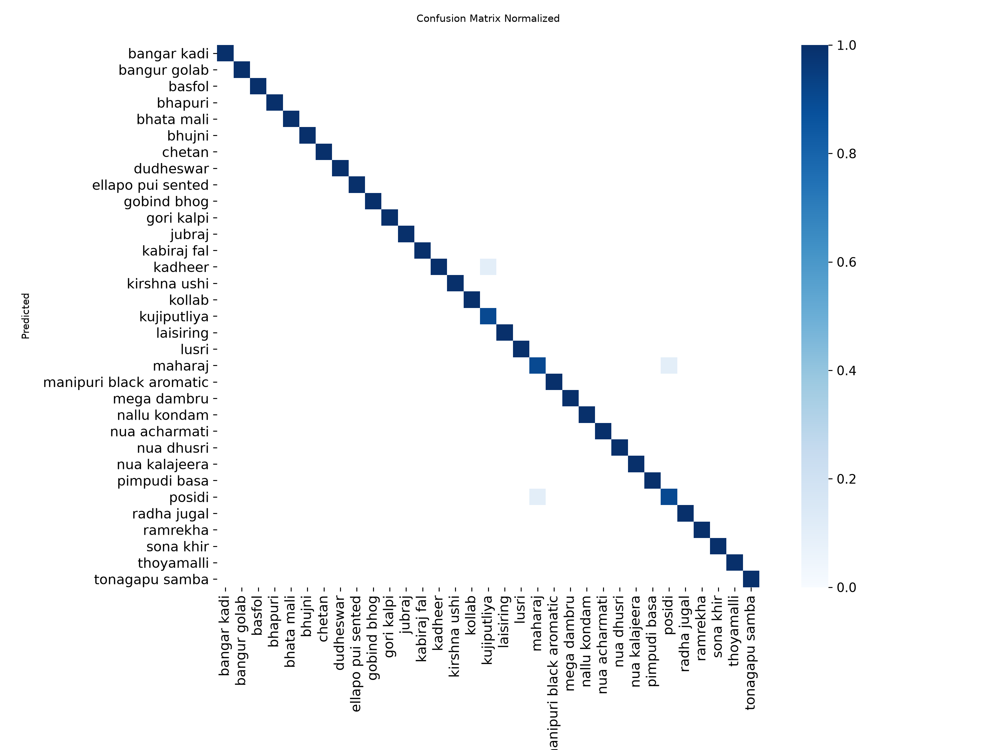

# CropAI — Model Documentation

## 1. Project Overview

CropAI is an AI-powered rice variety classification project designed to identify rice varieties from uploaded images and video frames.

The application uses a trained YOLO11 classification model to predict the most likely rice variety and display prediction confidence scores.

CropAI provides a Streamlit-based dashboard for image and video analysis, Top-5 predictions, CSV report generation, and maturity planning calculations.

## 2. Technology Stack

| Component | Technology |
|---|---|
| Programming Language | Python |
| Machine Learning Framework | Ultralytics |
| Model Architecture | YOLO11n Classification |
| Image Processing | OpenCV |
| Dashboard | Streamlit |
| Data Handling | Pandas |
| Image Handling | Pillow |

## 3. Dataset Information

The project uses a cleaned rice classification dataset.

Dataset directory:

`datasets/rice_classification_clean_v1`

Dataset statistics:

| Dataset Split | Number of Images |
|---|---:|
| Training | 2,476 |
| Validation | 302 |
| Testing | 324 |
| Total | 3,102 |

The dataset contains 33 rice variety classes organized into separate class folders.

The dataset is not included in the GitHub repository.

## 4. Model Architecture

CropAI uses the YOLO11n Classification model provided by Ultralytics.

The model is trained for image classification rather than object detection.

The model predicts the rice variety represented in an input image and returns class probabilities.

Trained model location:

`models/best.pt`

Model type: YOLO11n Classification

## 5. Training Configuration

The training script is:

`train_rice_classifier.py`

The configured training parameters are:

| Parameter | Value |
|---|---|
| Model | YOLO11n Classification |
| Epochs | 20 |
| Image Size | 224 × 224 |
| Batch Size | 8 |
| Device | CPU |
| Workers | 0 |
| Patience | 5 |
| Random Seed | 42 |

The training script checks the dataset directories and class-folder consistency before starting training.

It also prevents accidental overwriting of an existing training run.

## 6. Validation Results

The recorded validation results are:

| Metric | Result |
|---|---:|
| Top-1 Accuracy | 99.669% |
| Top-5 Accuracy | 100% |

These results represent validation performance and are reported separately from independent test-set performance.

## 7. Independent Test Evaluation

The independent test evaluation was successfully completed using:

`evaluate_rice_classifier.py`

The evaluation uses the separate test dataset split containing 324 images across 33 rice variety classes.

### Test Results

| Metric | Result |
|---|---:|
| Test Images | 324 |
| Number of Classes | 33 |
| Top-1 Accuracy | 99.07% |
| Top-5 Accuracy | 100.00% |

The model achieved 99.07% Top-1 accuracy and 100% Top-5 accuracy on the independent test split.

Top-1 accuracy measures whether the highest-ranked prediction matches the actual class.

Top-5 accuracy measures whether the correct class appears among the five highest-ranked predictions.

### Evaluation Configuration

| Parameter | Value |
|---|---|
| Dataset Split | Test |
| Image Size | 224 × 224 |
| Batch Size | 8 |
| Device | CPU |
| Workers | 0 |
| Framework | Ultralytics 8.4.183 |

### Confusion Matrix

The normalized confusion matrix provides a class-wise view of the model's classification performance.



The diagonal represents correct classifications, while off-diagonal entries indicate misclassifications.

The evaluation results are specific to this test dataset and do not guarantee identical performance on unseen real-world field conditions.

### Running the Evaluation

Activate the project virtual environment and execute:

```bash
python evaluate_rice_classifier.py
```

The evaluation generates confusion matrices and prediction visualizations in the Ultralytics run directory.

## 8. Application Features

The CropAI dashboard currently supports:

- Rice variety classification from uploaded images.
- Video analysis using sampled video frames.
- Top-5 classification predictions.
- Prediction confidence scores.
- CSV report generation.
- Maturity planning calculations.

The model classifies the most likely rice variety in the input image. Its confidence score should not be treated as a guarantee of correctness.

## 9. Installation and Setup

Use Python 3.12.10 and create a virtual environment.

```bash
python -m venv .venv
```

Activate it in Git Bash:

```bash
source .venv/Scripts/activate
```

Install dependencies:

```bash
pip install -r requirements.txt
```

Start the application:

```bash
streamlit run app.py
```

## 10. Project Limitations

- Classification performance depends on image quality, lighting, camera angle, and dataset coverage.
- The model predicts a rice variety; it does not identify individual plants.
- The application does not currently provide validated crop-health diagnosis.
- Confidence scores are model estimates, not guaranteed probabilities of correctness.
- Independent test performance is based on the available 324-image test dataset and may not represent all real-world conditions.

## 11. Future Improvements

Potential improvements include:

- Testing with more real-world field images and videos.
- Improving robustness under different lighting and environmental conditions.
- Analyzing class-wise errors and improving difficult classifications.
- Exploring crop-health analysis as a separate, properly validated capability.
- Expanding the dataset with additional rice varieties.

## 12. Repository Structure

```text
CropAI/
├── app.py
├── requirements.txt
├── train_rice_classifier.py
├── evaluate_rice_classifier.py
├── models/
│   └── best.pt
├── docs/
│   ├── MODEL_DOCUMENTATION.md
│   └── images/
│       └── confusion_matrix_test.png
└── datasets/
    └── rice_classification_clean_v1/
```

The dataset and local training artifacts are excluded from the GitHub repository.

---

**Documentation status:** Training, validation, and independent test evaluation have been completed and documented. Test results are based on the current dataset and should not be interpreted as guaranteed real-world performance.